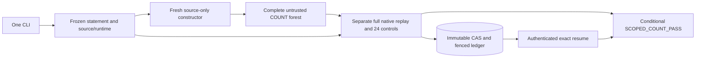

# Berry–Esseen: clean end-to-end reproduction

Authors: Kacper Rodziewicz and Bartosz Kołodziejek.

## Fresh complete COUNT and durable local CLI

Branch `implementation/count-native-v1` implements source-only construction,
separate full native acceptance and authenticated durable resume for the
complete ordinary `n6.B0.p61` forest. The original exact Farkas pilot remains
available. Both retain `full_proof_pass=false`; the full theorem is in progress.



After installing the local package from `formal/lean-map` with CPython 3.12:

```console
be run examples/count-native/project.toml --resume
```

[Install and run](formal/lean-map/docs/implementation/README.md) ·
[Exact COUNT scope and sources](formal/lean-map/docs/implementation/COUNT-NATIVE-PLAN.md) ·
[Runner and trust boundary](formal/lean-map/docs/implementation/COUNT-RUNNER.md) ·
[Independent audit](formal/lean-map/docs/implementation/COUNT-RUNNER-AUDIT.md) ·
[Actual CLI evidence](formal/lean-map/verification/count-native-check.json)

The source capsule excludes historical forests and acceptance receipts.
All seven count roots, closed split seams and original leaf boxes are checked.
Same-law parent acquisitions and all-law C6 are separate obligations. The
working Linux pilot is also recorded; no cloud or whole-proof PASS follows
from the local report. The current whole-proof frontier is explicit in the
[evidence gap ledger](formal/lean-map/docs/implementation/END-TO-END-GAP-LEDGER.md).

## Mathematical interfaces and execution architecture

[Mathematical proof graph](formal/lean-map/assets/proof-map.svg) ·
[Detailed interface graph](formal/lean-map/assets/interface-map.svg) ·
[Execution specification](formal/lean-map/docs/architecture/README.md) ·
[Parallelism review](formal/lean-map/docs/implementation/CONCURRENCY-REVIEW.md) ·
[Current plan](formal/lean-map/docs/plan.md)

The29 checked Lean sources retain their conditional analytic premises. Source
replay is an explicit numerical trust profile; it is not a Lean proof of the
interval kernel. Final theorem acceptance requires all fresh providers, exact
coverage, same-law resources and finite/tail composition.


---

**25 October2026 implementation update:**56I,57H,65 and67 have ready code;
the actual computations and universal analytic premises remain separate.
See the [new implementation checkpoint](proof/ready_implementations_20261025.md).

Three independent new n25 jobs can run now on the same Google Drive:

- [66_A —40 acquisition actions: open in Colab](https://colab.research.google.com/github/rodziewiczk/berry-esseen-end2end/blob/main/colab/66_A_40_acquisition_actions.ipynb)
- [66_B —10 additional COUNT forests: open in Colab](https://colab.research.google.com/github/rodziewiczk/berry-esseen-end2end/blob/main/colab/66_B_10_upper_counts.ipynb)
- [66_C —11 recovered original B5 forests: open in Colab](https://colab.research.google.com/github/rodziewiczk/berry-esseen-end2end/blob/main/colab/66_C_11_recovered_B5_counts.ipynb)

Select **Run all**. Code is fetched automatically from its immutable
published pin; no runtime ZIP upload is needed. These are three complete
components, with the full66 semantic union still separate. Completed01–07
are preserved.59B's old completed export now passes its full compatible reader.

The following24October execution census is historical; the linked25October
checkpoint supersedes its implementation queue and59B reader status.

**24 October 2026 execution checkpoint:** 74 existing tasks have completed
their declared arithmetic scope; 35, 46 and 59C are incomplete. Final local
exports were not found for 56H, 57F, 57G and 58G. Completed 59B additionally
needs a compatible full reader. See the [complete per-notebook register and
exact remaining implementation/execution list](proof/completion_and_remaining_20261024.md)
and its [machine-readable evidence ledger](proof/completion_and_remaining_20261024.json).
56I is ready in a local code handoff and awaits execution; ten further whole
units need implementation completion. The global proof remains unverified.

The [proof graph](proof/proof_graph.md) shows the mathematical statements and
their dependencies, including open analytic premises and missing n25 inputs.
The accompanying [conditional sufficiency argument](proof/remaining_notebooks_sufficiency.md)
explains the finite1--48 / uniform49+ reduction. Computational delivery is
tracked separately in the [selected implementation plan](proof/remaining_notebooks_closed_plan.md).

Start with [the current status](STATUS.md) and [the mathematical audit and
high-level proof graphs](proof/LOGICAL_AUDIT.md). The present priority is to
finish the listed implementations and executions, with the checks needed to
preserve their exact evidence and mathematical implications.
The follow-up [implementation and certificate-link audit](proof/CODE_INTERFACE_AUDIT.md)
records exact component matches, remaining enabled paths and the collector23 repair.

This repository rebuilds the computational proof obligations for the sharp iid Berry–Esseen constant from pinned public sources. It is a **work in progress**, not a completed proof of the conjecture.

For centered unit-variance iid laws with \(\rho(P)=E|X|^3\), the target is
\[
C_n=\sup_P\frac{\sqrt n\,\Delta_n(P)}{\rho(P)},\qquad
C^*=\sup_{n\ge1}C_n=\frac{3+\sqrt{10}}{6\sqrt{2\pi}}.
\]

Heavy mathematical calculations run in **Google Colab CPU sessions**. Local checks are limited to small infrastructure fixtures and source inspection. Separate sessions receive separate task directories; no two processes write the same forest or checkpoint.

## Current boundary

- Historical PASS records provide provenance and candidate certificates. They do not count as fresh acceptance in this repository.
- Search is untrusted. Complete native leaf replay, negative controls, source binding, domain coverage and analytic implication checks remain separate obligations.
- The global theorem remains open until every required node and edge passes a fresh complete run.
- Notebook 08 completed all six supplied n2/n3 arithmetic stages. The [observed-run record](proof/observed_runs.md) preserves the exact scope and execution details. The [standalone analytic review](proof/small_indices_analytic_review.md) and [checker source review](proof/small_indices_checker_review.md) found no blocking gap in the reviewed reductions and selected acceptance paths.
- No source research archives are deleted or rewritten.

The initial executable task is the reconstruction of seven missing **n=25** count forests. Five preserve original V12 designs; two are explicitly new conditional V14 epochs. They are not seven missing components of cutoff49.

## Colab

The current n25 count set is `01_RESTART_...` through `07_RESTART_...` in
`colab/`, with the matching notebook24. Its restored PREFIX2 discovery strategy
preserves saved trees, uses original lookahead/cuts/accelerators, and records an
explicit lossless checkpoint migration. Source/JSON migration was checked on
actual saved exports for all seven targets; this is not fresh leaf acceptance
or a measured speedup. All mathematical checks and the existing bounded resource
policies remain in force. The old01–07 and the separate q2-only25 are in
`colab/archive/`. See the [current execution instructions](colab/README.md) and
[cache handoff inventory](proof/count_cache_handoff.md).

The first seven notebooks rebuild the missing n25 count forests. Notebook 08 checks n2/n3. Notebooks 09–12 rebuild n25 INITIAL/resource premises, the complete n4 root and the retained tail49 arithmetic. Queued notebook 13 checks the independent n5 gap-free corner, including both infinite phase rays. Notebooks 14–22 replay the auxiliary n21–24 arithmetic supplying the selected n25 predecessor bound; notebook 23 joins their finished evidence.

The numbered notebooks in `colab/` are preconfigured for separate CPU sessions. Notebooks 09–12 can run while 01–07 continue.
See [the English upload-and-run instructions](colab/README.md).

Queued notebook24 imports the finished 01–07 and 09/10 bundles and verifies
their [seven conditional resource-to-count interfaces](proof/n25_collect_execution.md).
It preserves original evidence and does not repeat their heavy mathematics.
The [remaining n25 scope](proof/n25_completion_scope.md) and
[selected regional input inventory](proof/n25_regional_selection.json) keep
the other n25 domains explicit.

Queued notebooks26–28 freshly replay75 already complete retained B0--B2 count
forests,94,288 leaves. Each batch saves and fully revalidates completed stages
across sessions. These are additional conditional count components, with
parent/local resources and analytic implications still separate. See the
[retained execution scope](proof/retained_n25_execution.md).

Notebook35 now packages the remaining selected n5 arithmetic:326jobs including
295complete count forests, with validated completed-job reuse. Its
[execution specification](proof/n5_remaining_execution.md) keeps support,
parent/count semantic joins and the separate notebook13 gap-free result
explicit. Infrastructure preparation does not establish fresh numerical
acceptance or the unrestricted n5 theorem.

Notebook 53 now packages the complete selected n26--30 COUNT lane. Run 64 to
completion with the same Drive, then Run all in
[53_n26_30_conditional_counts.ipynb](colab/53_n26_30_conditional_counts.ipynb).
It revalidates the exact recovered historical tree and runs the other 79 full
acceptors. All 80 forests and their original controls are required; parent
acquisition and the all-law theorem remain separate. See
[the execution scope](proof/finite2630_execution.md).

Notebook56A is the separately runnable original auxiliary9--14 Fourier part
of the larger parent package56. It runs the full original plan, construction,
replay and independent readback with unchanged sources and controls. Choose
Run all in [56A_n10_14_auxiliary_fourier.ipynb](colab/56A_n10_14_auxiliary_fourier.ipynb).
Support/HIGH, INITIAL/resources and the217count interfaces remain separate.
See [its exact execution scope](proof/finite1014_parent_auxiliary_execution.md)
and [the bounded infrastructure review](proof/finite1014_parent_auxiliary_root_review.md).

The separate [56B_n10_14_supported_fourier.ipynb](colab/56B_n10_14_supported_fourier.ipynb)
runs the unchanged supported two-band Fourier calculation. It preserves the
explicit |X|<=3 premise; support acquisition and complete56remain separate.
See [its scope](proof/finite1014_supported_execution.md) and
[the bounded source/infrastructure review](proof/finite1014_supported_root_review.md).

The separate [56C_n10_14_highrho_fourier.ipynb](colab/56C_n10_14_highrho_fourier.ipynb)
packages the original high-rho Fourier calculation for literal n10--14.
Its finite integration, selected published tail and conditional analytic
premises remain distinct from full56. See [scope](proof/finite1014_highrho_execution.md).

The fourth original Fourier family is
[56D_n10_14_corner_fourier.ipynb](colab/56D_n10_14_corner_fourier.ipynb).
It covers the closed rho interval[23/20,71/50] with the explicit support3
premise. It leaves support acquisition and the remaining56parents/interfaces
separate; see [scope](proof/finite1014_corner_execution.md).

The shared scalar certificate has its own full original execution in
[56K_kappa_62_625.ipynb](colab/56K_kappa_62_625.ipynb). It checks all 81 cells,
1134 positive coefficients and original controls without repeating any Fourier
integration. Run all with the same Drive; see [scope](proof/finite1014_kappa_execution.md).
The current [notebook completion queue](proof/notebook_completion_queue.md)
separates delivered files, running jobs and packages still being implemented.

[58A_n21_24_highrho_support.ipynb](colab/58A_n21_24_highrho_support.ipynb)
runs both original actual21--24 high-rho support passes with all original
controls. Its retained Fourier and sharp-predecessor premises remain explicit;
see [the execution scope](proof/finite2124_high_execution.md).

The n15--19 Fourier parts are now separately runnable:
[57A auxiliary](colab/57A_n15_19_auxiliary_fourier.ipynb),
[57B supported](colab/57B_n15_19_supported_fourier.ipynb), and
[57C high-rho](colab/57C_n15_19_highrho_fourier.ipynb).
Each retains all six original literal indices14--19 and all four original
actions; see [the shared execution scope](proof/finite1519_fourier_execution.md).

[56E_n10_14_supported_high.ipynb](colab/56E_n10_14_supported_high.ipynb)
executes both full original supported-HIGH passes and the original independent
readback. Its two specific support radii remain explicit premises; see
[scope](proof/finite1014_high_execution.md).

Full original support passes are available in
[56F for10--14](colab/56F_n10_14_coarse_support.ipynb) and
[57D for15--19](colab/57D_n15_19_full_ray_support.ipynb).
They preserve their distinct predecessor/domain assumptions; see
[56F scope](proof/finite1014_coarse_execution.md) and
[57D scope](proof/finite1519_support_execution.md).

The current12-hour settings in RESTART01–07 are budgets, not completion estimates.
A complete tree still requires a separate full acceptor run. An unfinished tree
is checkpointed for a compatible rerun.

Account authentication is performed by the user. VM-local work and durable checkpoint storage must use distinct paths. A timeout preserves an incomplete candidate; it never produces a certificate.

## Sources and provenance

The previous [research repository](https://github.com/rodziewiczk/berry-esseen-045-certificate) is an immutable source of selected code and archives, not the working tree of this rebuild. Initial code reference: `75a94708872e2bc053f42a279559b23ed91e4402`.

Earlier papers: [v1](https://hexagonmath.org/2610.00147v1), [v2](https://hexagonmath.org/2610.00147v2), [v3](https://hexagonmath.org/2610.00147v3). Their statements must be checked against the current analytic reductions. Earlier claims are not used as new all-index theorems.

Only necessary frozen code belongs under `vendor/`. Each imported byte is hash-bound and retains its original attribution. Archives, generated trees and runtime logs are excluded from Git; accepted reproducibility assets will be published separately.

## Proof and paper

The [remaining-work roadmap](proof/remaining_work_roadmap.md) distinguishes the
current notebook queue from the complete theorem. The total number of remaining
notebooks is not yet established; several finite-range and analytic obligations
still need an executable source/acquisition map.

`proof/obligations.json` records the proof graph and unresolved edges. `proof/analytic_audit.md` records the initial analytic review; [the small-index review](proof/small_indices_analytic_review.md), [primary-source statement checks](proof/literature_inputs.md), and [the direct pointwise Prawitz proof](proof/prawitz_majorant_review.md) add the subsequent findings. A new concise English paper will follow the verified minimal graph, with explicit literature inputs and no unsupported all-index completion claim.

ChatGPT and Codex assist with proofs, certificates and writing, using the user-identified GPT-5.6 Sol, GPT-6.1 Sol and GPT-6 Astra models. This is not a claim of full human review or whole-paper formal verification.

The next work is specified in [the n5 interface review](proof/n5_analytic_review.md), [the finite-range source inventory](proof/finite_range_replay_inventory.md), and [the stronger24 premise audit](proof/stronger24_replay_scope.md). The [auxiliary execution package](proof/aux24_execution.md) implements the queued numerical work. The auxiliary-premise audit does not invalidate or require restarting the running conditional n25 jobs. Their final all-law composition still needs a freshly acquired matching premise and the complete resource/count joins.

The [bounded n25 forest inventory](proof/n25_missing_forest_inventory.md) distinguishes the historical report claiming completion from the seven selected forest payloads that were not located in the inspected packages. The available partial checkpoints and newly prepared V14 alternatives are explicitly identified; a historical result hash does not supply its missing certificate bytes.

## Recovered-original n25 implementation

The new [recovered-original execution route](proof/n25_recovery_integration.md)
imports the eleven original B5 forests (32,093 leaves) directly into the full
unchanged native acceptor. It needs no discovery/PREFIX2 and keeps LIMIT=10000,
all original source/candidate identities and all 24 corruption controls.
The exact original mixed parents and regional selectors are also available as
source/provenance. This is an implemented subsection of 66, not completion of
its mixed replay, resource acquisitions or whole 20-piece union. Preserve 01–07.
See [the recovery instructions](README_RECOVERY_PL.md).

Published notebook sources also include the final Drive synchronization and
Colab runtime-release cell. It executes only when Run all reaches that cell;
a synchronization error prevents release. Older already-open notebook copies
do not automatically receive this change.
