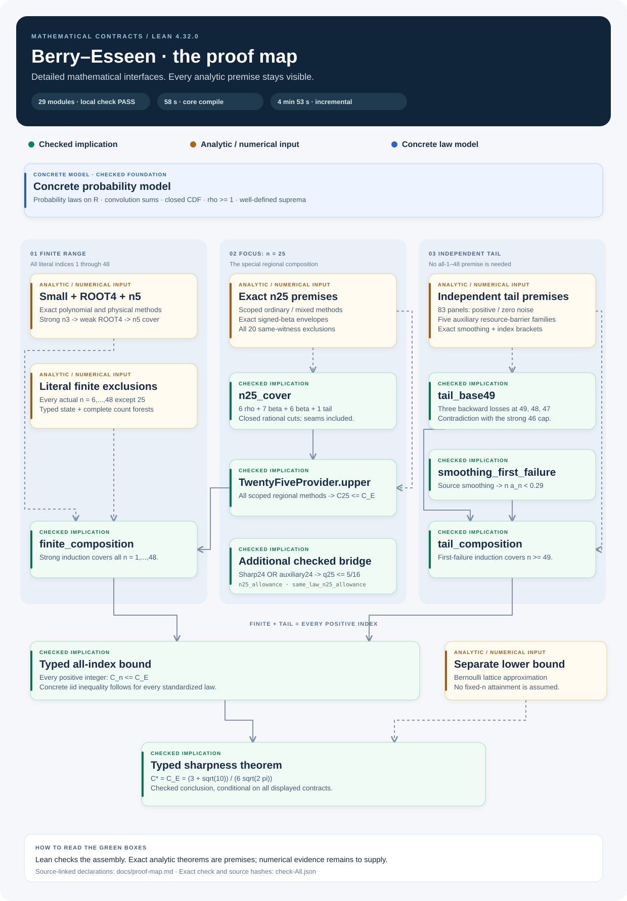

# Berry–Esseen · mathematical interfaces and the Lean proof map

**Concrete mathematical contracts → checked conditional assembly → implementation.**

**Executable local pilot on `implementation/local-pilot-v1`:**
[install and run](docs/implementation/README.md) the complete scoped path
`be run examples/local-pilot/project.toml --resume`.
It produces and independently verifies an exact source-bound Farkas
certificate, persists results and resumes from checked cache. Its
`PILOT_PASS` is limited to the documented moment context;
`full_proof_pass` remains false.

**Current work on `architecture/execution-v1`:** the
[execution specification](docs/architecture/README.md) defines one CLI,
source-bound cache, independent verification, complete PASS conditions,
parallel Google Cloud execution and the campaign budget/deadline.
The complete production proof runner remains a later implementation stage.


[Architecture graph](assets/execution-map.svg) ·
[Architecture decisions](docs/architecture/00-decisions.md) ·
[Implementation acceptance plan](docs/architecture/06-validation-and-rollout.md)



[Full proof graph](assets/proof-map.svg) · [PNG](assets/proof-map.png) ·
[Detailed interface graph](assets/interface-map.svg) · [Source-linked guide](docs/proof-map.md)

Version **0.2** develops the mathematical interface in detail. It is a solid
Lean skeleton under **explicit, precisely stated analytic assumptions**.
The intended handoff is that an implementer chooses algorithms and scheduling,
while the mathematical meaning, units, domains, coverage and acceptance
conditions are already specified.

Start with the [five-part specification](docs/contracts/README.md), the
[source-alignment audit](docs/contracts/AUDIT.md), and the
[current plan](docs/plan.md). The exact target is in the
[mathematical overview](docs/mathematical-contracts.md).

## The five interfaces

| Part | What is specified and connected |
|---|---|
| [1. Mathematical states](docs/contracts/01-state.md) | Actual law, contact floor, raw and normalized thresholds, signed moments, asymmetric support, distinct defects, conditional noise and joint budgets |
| [2. Transitions](docs/contracts/02-transitions.md) | Required inputs, exact analytic conclusions, guards, outward rounding, actual-index scaling and finite resource refinement |
| [3. Coverage and methods](docs/contracts/03-covers-and-methods.md) | n5 and n25 regions, floor31 bands, every original count root, seams, zero cases, complete finite trees and exterior tails |
| [4. Certificate semantics](docs/contracts/04-certificates-and-trust.md) | Frozen rational tasks, law-quantified meaning, payloads, checker soundness and rejection/unresolved outcomes |
| [5. Final assembly](docs/contracts/05-assembly.md) | Typed providers construct the finite contracts, which combine with the independent tail and lower approximation |

The source-specific contracts cover [n2/n3](docs/contracts/SMALL-INDICES.md),
[ROOT4](docs/contracts/ROOT4.md), [LOW and Prawitz](docs/contracts/FOURIER-FAMILIES.md),
[complete HIGH families](docs/contracts/HIGH.md),
[mixed n25 mathematics](docs/contracts/MIXED.md),
[mixed reference admission and lookup](docs/contracts/MIXED-REGISTRY.md), and
[ordinary COUNT rule meanings](docs/contracts/COUNT-RULES.md).
The independent tail has its own [uniform local-comparison contract](docs/contracts/UNIFORM-TAIL.md)
and [auxiliary resource-barrier/assembly contract](docs/contracts/TAIL-ASSEMBLY.md).
The [reuse ledger](docs/contracts/reuse-ledger.md) inventories the earlier Lean
work and records semantic compatibility rather than relying on matching names.

## What “green” means

Lean checks coverage, algebra, type distinctions and conditional composition.
For example, the n5 and floor31 covers are proved; the ROOT4 adapter preserves
its weak target; the mixed transfer uses the same law without inventing an
index24 contact; and the final theorem consumes the typed providers.

Analytic theorems are accepted as named parameters with exact scope. Their
full Lean proofs are outside this stage. Numerical producers, byte decoders
and the full production checker still have to provide objects with the
specified semantics. A historical PASS or a matching file hash supplies no
mathematical proof field by itself.

The [verification report](check-All.json) binds the checked Lean sources by
SHA-256; the [compiler log](check-All.log) includes theorem signatures and
logical axiom lists. Type-level negative controls are in
[`InterfaceChecks.lean`](BEMap/InterfaceChecks.lean). The check uses neither
`sorry`, custom `axiom` declarations nor `native_decide` in this project.
It reuses compiled mathlib dependencies and does not run the heavy numerical
kernels. This is a local compiler result; there is no claim of a CI run.

## The composition

| Branch | Checked structure |
|---|---|
| n2/n3 | Distinct polynomial bases, payload meanings and quantitative targets |
| ROOT4 | Chosen owner, canonical three-point reference, common defect measure and weak target below C_E |
| n5 | Thirteen low regions, six supported Fourier bands and an inclusive rho tail |
| n25 | Twenty closed regions, signed-beta envelopes, ordinary and mixed evidence, Sharp24 OR auxiliary24 allowance |
| Literal n6–48 | Actual-index providers with same-law state and complete count forests |
| Independent n49+ | Typed 83-panel uniform comparison, five auxiliary resource-barrier families, then checked base49 and first-failure induction |
| Final theorem | `all_indices_from_typed_providers`; separate lower approximation gives `sharp_from_typed_providers` |

There is no finite 1–48 premise in the independent tail theorem. The
[declaration guide](docs/proof-map.md) and [dependency map](docs/dependencies.md)
make that distinction explicit.

## Check using an existing mathlib cache

```powershell
.\check.ps1 -Scope Core
.\check.ps1
.\check.ps1 -ReuseVerified
```

The helper detects Lean 4.32.0 and defaults to the previous dependency cache
under `$env:USERPROFILE\Desktop\eventual_exactness_proof`. To select a cache:

```powershell
.\check.ps1 -MathlibWorkspace 'C:\path\to\existing-project' `
  -LeanExe 'C:\path\to\lean.exe'
```

It checks the pinned toolchain and dependency revision, derives a topological
order for every project Lean source, recompiles them, and rejects sources
changed during the check. Reports record per-module times, exit codes and
hashes. `Core` checks only the three scalar finite/cover25/tail modules; `All`
also checks the detailed mathematical interfaces and final assembly.

`-ReuseVerified` is optional and requires a preceding successful full compiler
record. It verifies unchanged project source/artifact/dependency hashes and
recompiles changed modules plus their consumers. Reports label every reused
artifact. The [verification history](verification/README.md) preserves the
fresh 27-source checkpoint (15 minutes 4 seconds) separately from later
incremental checks. Omitting the flag always recompiles the selected sources.

## Portable Lake build

Lean is pinned to 4.32.0 and mathlib to
`81a5d257c8e410db227a6665ed08f64fea08e997`:

```text
lake update
lake exe cache get
lake build
lake env lean Audit.lean
```

Fetching dependencies on a new machine is separate from checking these
interfaces. The supplied report documents the direct compiler check actually
performed; it does not claim a fresh Lake build.

## Regenerate the diagrams

```text
python tools/render_proof_map.py
python tools/render_interface_map.py
python tools/render_execution_map.py
```

The mathematical renderers validate declaration anchors, recorded source
hashes and the displayed grouped edges before writing SVG, Mermaid and JSON.
The execution renderer validates links to the architecture specification;
its graph describes specified components, not already implemented services.
PNG files are rendered copies. These are curated views of theorem interfaces,
not automatic exports of internal kernel proof terms.

## Provenance

* [Research repository](https://github.com/rodziewiczk/berry-esseen-end2end)
* [Proof-map branch](https://github.com/rodziewiczk/berry-esseen-end2end/tree/lean/proof-map)
* [Standalone interface repository](https://github.com/rodziewiczk/berry-esseen-lean-map)

The research baseline is `6ca9730273c81447be4863824c0b7d012db0e8b8`.
The original research work in progress was preserved. Reused foundational
sources and their namespace/import changes are recorded in
[`provenance.json`](provenance.json); the original [MIT notice](LICENSE) is retained.

The mathematical specification and conditional Lean assembly are the v0.2
foundation. This branch adds the execution architecture and wire-format
specification. Production numerical execution and a cloud CLI follow these
interfaces; no paid cloud compute is launched by this documentation milestone.
