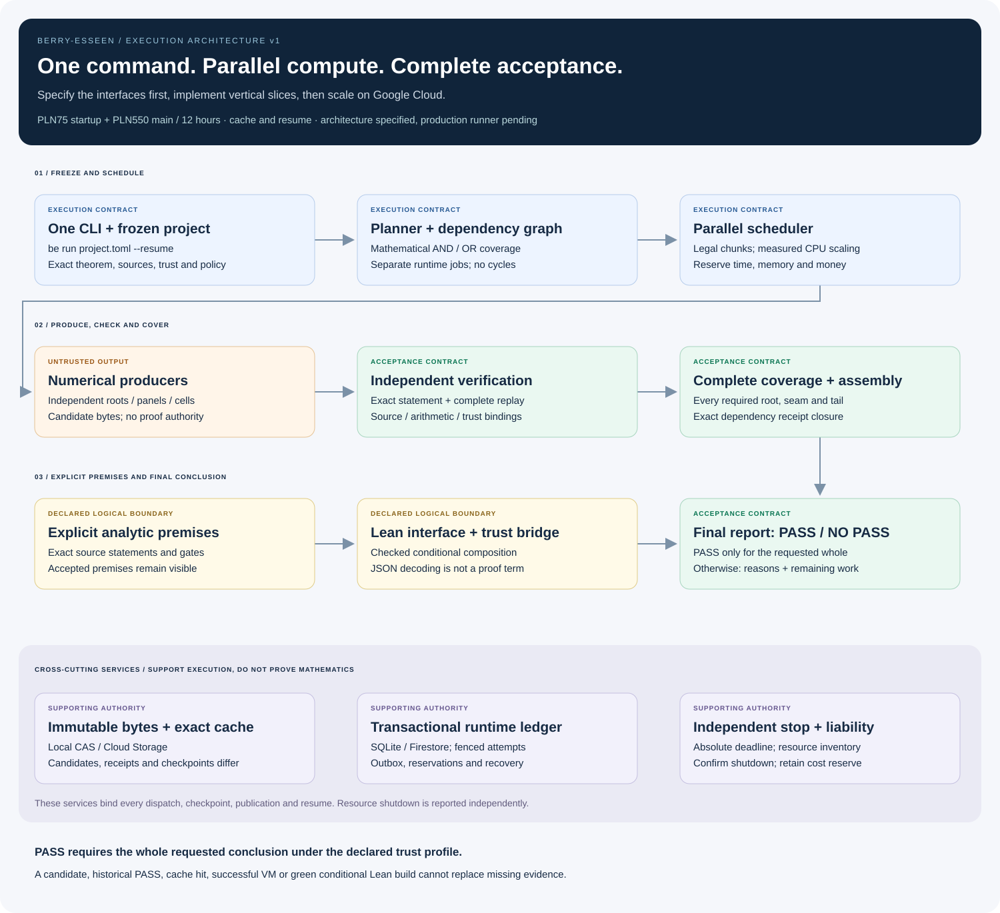

# Execution architecture: specification before implementation

Status: **architecture contract v1**, on `architecture/execution-v1`.
This directory specifies the production system; it does not claim that the
runner, cloud backend or full numerical proof has already been implemented.
The [mathematical contracts](../contracts/README.md) and the checked Lean
skeleton remain the semantic foundation.



[Full graph](../../assets/execution-map.svg) ·
[PNG](../../assets/execution-map.png) ·
[Machine-readable graph](../../assets/execution-map.json) ·
[Mermaid source](../../assets/execution-map.mmd)

## The user contract

```text
be run project.toml --resume
```

One invocation validates and freezes the project, finds reusable results,
plans missing work, executes producers and independent verification, checks
complete coverage, assembles the requested conclusion and reports the result.
After a restart the same command resumes the same campaign. A new invocation
does not replenish its money or reset its deadline.

The final verdict is **PASS** only when the complete requested theorem is
supported under the exact declared analytic assumptions and trust profile.
Every other result is **NO PASS**, with a reason and the remaining obligations.
Candidate production, an empty queue, successful cloud jobs, a cache hit and
compilation of the conditional Lean skeleton cannot individually produce PASS.
PASS describes mathematical acceptance under declared premises; shutdown and
remaining cost liability are reported separately and must never be hidden.
Process exit0 additionally requires successful operational closure; a cleanup
failure returns exit5 while preserving any valid mathematical PASS receipt.
The exit policy and exact acceptance predicate are specified in
[execution](02-execution.md) and [checkers and Lean](04-checkers-and-lean.md).

## Read in this order

| Document | Implementation questions it must settle |
|---|---|
| [00. Decisions](00-decisions.md) | Scope, authority, budgets, languages and the rules for changing this contract |
| [01. Protocol and types](01-protocol-and-types.md) | Exact bytes, rational values, statement identity, artifacts, receipts, control and budget types |
| [02. Execution](02-execution.md) | One CLI, DAG expansion, scheduling, parallelism, attempts, fencing, retries and final verdict |
| [03. Storage and recovery](03-storage-and-recovery.md) | Local/cloud authority, transactions, immutable publication, cache, checkpoints and recovery |
| [04. Checkers and Lean](04-checkers-and-lean.md) | Every supported family, acceptance meaning, trust boundary, complete coverage and final theorem linkage |
| [05. Compute and deployment](05-compute-and-deployment.md) | Google Cloud mapping, CPU allocation, calibration, cost reservation, global deadline and independent shutdown |
| [06. Validation and rollout](06-validation-and-rollout.md) | Implementation order, failure scenarios and evidence required before paid scale-up |
| [07. Reproducibility](07-reproducibility.md) | Clean local recomputation, portable offline evidence, public input closure and no dependence on the author's cloud account |
| [Audit](AUDIT.md) | Adversarial findings, their disposition and any remaining release gates |

The closed [JSON schemas](../../schemas/architecture/) define structural
wire types. [Examples](../../examples/architecture/) exercise the format;
they are design fixtures, not numerical proof certificates. Structural
schema validation is only the first layer: canonical encoding, identities,
semantic meaning, source binding, coverage and trust checks remain required.

The [architecture check record](../../verification/architecture-check.json)
records offline schema resolution, canonical/identity controls, fixture
bindings, local links and preservation of the 29 previously checked Lean
sources. It does not record a new Lean compilation, numerical proof or cloud
fault trial. The [read-only cloud preflight](../../verification/cloud-preflight.json)
records current account configuration/quotas without publishing account IDs.

## Responsibility split

Two architecture views are developed together: the protocol/checker/Lean
boundary, and execution/storage/cloud/performance. The independent auditor
tests their agreement against the mathematics and against crash, concurrency
and budget failure scenarios. The integrated specification is the handoff
to implementers. Any unresolved prerequisite must become an explicit release
gate; it must not be silently chosen inside an adapter.

Algorithmic review is part of this audit: prefer simple indexed/incremental
workflows, bounded streaming, safe reuse and measured parallel scaling over
redundant full scans, copying or additional infrastructure. A proposed speedup
must preserve mathematical meaning and be measured before being advertised.

Implementation then proceeds in vertical slices. First prove that the whole
path can reject bad input and accept one correctly bound small certificate.
Then add the complete mathematical families, and only then expand paid
parallel compute. [Rollout gates](06-validation-and-rollout.md) define the
evidence needed at each step.
