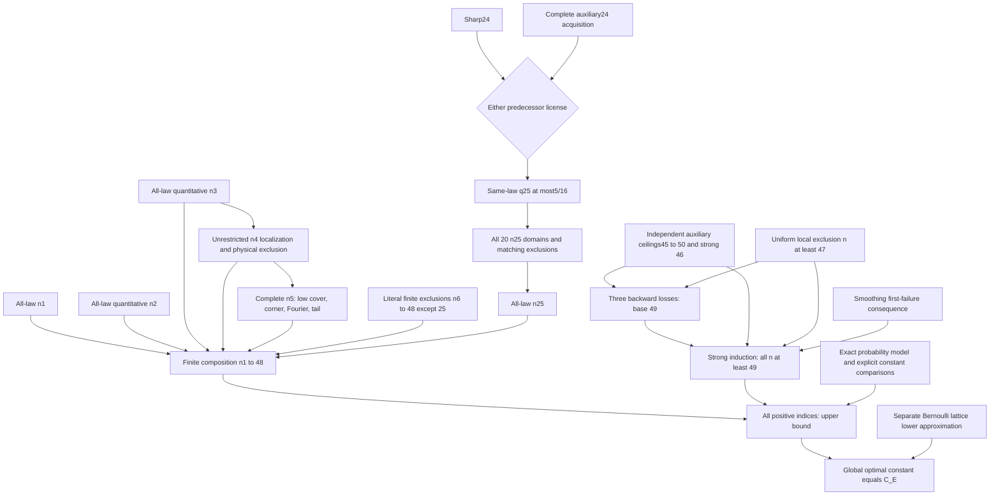

# Conditional dependency map

Solid dependencies below describe the mathematical contracts in this package.
All leaf analytic and numerical results remain open unless explicitly listed
as checked logical glue. No numerical notebook was executed for this skeleton.

`FiniteContracts.ordinary` also admits a sufficient sequential proof using
earlier sharp bounds. An independently licensed actual-index proof may ignore
that argument. There is no FIN -> TAIL arrow. The displayed sharp24 route is
compatible with the sequential finite proof; the auxiliary24 route is an
alternative and must include its full acquisition proof.

Checked glue:

| Lean theorem | Checked implication |
|---|---|
| `finite_composition` | The finite contracts cover every integer1 through 48 |
| `n25_allowance` | Either predecessor license gives the rational allowance |
| `same_law_n25_allowance` | The allowance applies to the same law at 24 |
| `ClosedChain.cover`, `n25_cover` | Closed rational cuts leave no n25 gap, assuming the stated envelopes |
| `n25_exclude_by_cover`, `n25_upper_of_regions` | Complete same-witness regional exclusions imply the n25 upper bound |
| `ContactPipeline.reject` | All pipeline transitions at the same n and contact compose |
| `tail_base49` | Auxiliary and local contracts imply the base 49 bound |
| `tail_composition` | Base49 and first-failure contracts cover the infinite tail |
| `all_indices_upper` | Finite and independent tail bounds cover all n >= 1 |
| `sharp_global_constant` | Upper bound and separate lower approximation give the exact supremum |

The files are a typed logical map. They are not an implementation of LOW,
HIGH, ROOT4, COUNT, interval kernels, resource iteration or certificate parsing.
