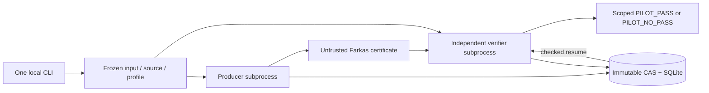

# Executable proof stages

The `implementation/count-native-v1` branch adds genuine source-only
construction and separate full native acceptance of the complete ordinary
`n6.B0.p61` COUNT forest through the same CLI:

```console
be run examples/count-native/project.toml --resume
```

See the exact [COUNT runner contract](COUNT-RUNNER.md), [source and mathematical
scope](COUNT-NATIVE-PLAN.md), [whole-proof gap ledger](END-TO-END-GAP-LEDGER.md)
and [parallel execution review](CONCURRENCY-REVIEW.md). This prints only
`SCOPED_COUNT_PASS`; the full theorem has not yet passed. The original small
exact Farkas workflow below remains available.

The `implementation/local-pilot-v1` branch implements one complete local
workflow: freeze input/source/environment, produce a certificate in one
subprocess, verify it in another, store immutable outputs, commit fenced
SQLite/WAL completion and report the exact scoped result. It implements the
[zero-noise joint-cubic pilot](LOCAL-PILOT-SPEC.md), not all COUNT families
or the full Berry–Esseen proof.



## Install from the public checkout

Use CPython 3.12. In the research repository enter `formal/lean-map` first;
in the standalone interface repository use its root. The schema and source
capsules stay in that checkout, so this first release uses editable installation.

Windows PowerShell:

```powershell
py -3.12 -m venv .venv
.\.venv\Scripts\python.exe -m pip install -e .
.\.venv\Scripts\be.exe run examples/local-pilot/project.toml --resume
```

Linux with CPython 3.12:

```sh
python3.12 -m venv .venv
.venv/bin/python -m pip install -e .
.venv/bin/be run examples/local-pilot/project.toml --resume
```

Once the environment is active, the proof command is simply:

```text
be run examples/local-pilot/project.toml --resume
```

Exact runtime versions are pinned in `pyproject.toml` and
`tools/requirements-local-pilot.txt`; build pins are separate. Install from
an offline wheelhouse by first installing the runtime and build lock files
with `--no-index --find-links`, then use `pip install --no-index
--no-build-isolation --no-deps -e .`. No Google Cloud account is needed.
An installed wheel separated from its public source/schema checkout is not
a supported distribution of this initial slice.

## Results and controls

| Command/project | Expected result |
|---|---|
| `run examples/local-pilot/project.toml --resume` | `PILOT_PASS`: p=1/4, rho=1 contradicts the exact necessary moment system |
| Repeat the same command | Same campaign and exact candidate/receipt; no extra producer/verifier attempts; independent mathematical readback |
| `run examples/local-pilot/feasible/project.toml --resume` | `PILOT_NO_PASS`: p=1/2, rho=1 is not excluded |
| `run examples/local-pilot/wide-rho/project.toml --resume` | `PILOT_NO_PASS`: the necessary relaxation is not excluded over rho in [1,2] |
| `run ... --fresh` | Explicit new no-paid local campaign; rerun both jobs |

`--state-dir PATH` selects an ordinary local durable state directory. A
new invocation with `--resume` cannot reset an existing campaign deadline
or inherit old acceptance after a changed context, source, environment or
resource policy. `--fresh` authorizes only a new local pilot campaign.
One state directory owns one project head. Moving an otherwise identical
TOML file does not change that head, its deadline or accepted results.
Independent projects use separate state directories.
An incompatible older state head is rejected without creating a new
campaign. A new local campaign requires explicit `--fresh`.

Every successful report says `full_proof_pass=false`, names its exact
scope and retains the accepted analytic interpretation. Exit0 means this
pilot passed; exit2 includes a valid context with no verified exclusion or
unfinished work; exit3 is invalid/unsupported input/profile; exit4 is
rejected numerical evidence; exit5 is an execution/storage failure.

The CAS verifies full bytes/length/type on reuse. SQLite records producer
and verifier jobs, attempt generations, private token digests, completion
idempotency and events. A corrupted cached artifact fails; an outcome string
alone is never accepted. Current receipt readback rederives the small exact
system and checks the certificate again. The source, dependency files and
actual interpreter/profile bind cache identity.

## Run the checks

```text
python -m unittest discover -s tests -v
```

Use the installed pilot environment for this command. Tests include exact
mathematical positive/negative cases, malformed data, forged bindings,
corrupted CAS, concurrent SQLite claims, stale leases and real CLI recovery.
The [implementation audit](LOCAL-PILOT-AUDIT.md) and the recorded
[local check](../../verification/local-pilot-check.json) distinguish actual
execution evidence from future gates.

The local engine enforces bounded input/output and wall time and records
platform enforcement honestly. Windows does not claim a hard process-memory
limit; POSIX resource enforcement needs its own platform trial. This slice
does not implement the GCP backend, portable bundle export/import, arbitrary
mathematical DAGs, every numerical family or a Lean-kernel trace decoder.

The next implementation step should extend the existing tested ports to a
complete finite domain/cover and its exact source-derived rules. Existing
analytic assumptions, full forest/tail coverage and final theorem obligations
remain those in the architecture and mathematical contracts.
