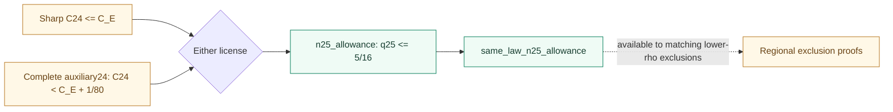

# The proof map linked to Lean declarations


[Open full SVG](../assets/proof-map.svg) · [PNG](../assets/proof-map.png) ·
[Machine-readable map](proof-map.json) · [Current plan](plan.md)

Green means **a proved implication with explicit inputs**. Amber means a
mathematical input which is not discharged in this Lean project. Blue is the
concrete probability model and its elementary proved API. The local compiler
checked all 8 files; it did not run the numerical notebooks.

This is a curated, grouped map of the Lean theorem interfaces, not an automatic
export of the kernel's proof-term graph. Where several assumptions are grouped
in one box, consult the theorem signature for their exact conjunction. The
additional predecessor bridge is displayed separately: its conclusion is one
of the possible licenses used by a future regional exclusion proof, rather
than an extra argument of `n25_cover`.

## Exact declarations behind the boxes

| Box | Lean declaration | Meaning at this checkpoint |
|---|---|---|
| Concrete model | [`normalizedScore_le_optimalConstant`](../BEMap/Foundations/OptimalConstant.lean) | Genuine law/CDF/supremum semantics, not an arbitrary score variable |
| Small indices and ordinary finite inputs | [`FiniteContracts`](../BEMap/Finite.lean), [`ConstantComparisons`](../BEMap.lean) | All required incoming bounds remain explicit |
| Finite range | [`finite_composition`](../BEMap/Finite.lean) | Checked strong-induction composition for every 1<=n<=48 |
| n25 inputs | [`ContactExtraction`, `n25_upper_of_regions`](../BEMap/Interfaces.lean), [`MiddleEnvelope25`, `HighEnvelope25`](../BEMap/Cover25.lean) | Unrestricted contact, signed-beta envelopes and all regional rejection proofs |
| n25 closed cover | [`n25_cover`](../BEMap/Cover25.lean) | All 20 listed cells cover the feasible domain, assuming the envelopes |
| n25 conclusion | [`n25_upper_of_regions`](../BEMap/Interfaces.lean) | Complete same-witness regional rejections imply C25<=C_E |
| Additional predecessor bridge | [`n25_allowance`](../BEMap/Finite.lean), [`same_law_n25_allowance`](../BEMap/Interfaces.lean) | Sharp24 OR auxiliary24 gives q25<=5/16 for the same law |
| Tail inputs | [`TailContracts`](../BEMap/Tail.lean) | Auxiliary ceilings, local exclusion, smoothing consequence and numerical bracket |
| Base49 | [`tail_base49`](../BEMap/Tail.lean) | Three exact backward losses contradict the strong 46 cap |
| Infinite tail | [`tail_composition`](../BEMap/Tail.lean) | First-failure induction covers all n>=49 |
| Every index | [`all_indices_upper`](../BEMap.lean) | Finite 1--48 and independent 49+ imply the upper bound for every positive integer |
| Lower approximation | [`LowerApproximation`](../BEMap.lean) | Separate open Bernoulli/lattice lower-bound obligation |
| Sharp constant | [`sharp_global_constant`](../BEMap.lean) | Conditional equality of the concrete global supremum with C_E |

The source-linked JSON includes the exact line of every declaration anchor.
The finite and tail theorem records provide the detailed inputs behind grouped
boxes; their fields are not claims of completed numerical proofs.

## The n25 predecessor alternative



The sharp route fits the sufficient finite induction. The auxiliary route is
an alternative, not a requirement to prove both. Either license bounds the
same law at 24; it never turns the index25 contact into an index24 contact.

## The tail's independence

`tail_composition` has `TailContracts C c` as its only proof-record input.
The entire finite 1--48 upper bound is not an argument. Its base 49 uses the
local exclusion at 49,48,47 and auxiliary bounds near46. For the later index50
step, the second deleted-index cap uses the auxiliary bound at 48. The
smoothing premise supplies the scaled0.29 estimate at any later first failure.

This distinction is visible in the SVG: there is no arrow from the finite
composition to the tail composition. Both branches meet at the all-indices
theorem.

## Reproduce and inspect

```
python tools/render_proof_map.py
```

This standard-library script verifies all 8 recorded Lean source hashes,
declaration anchors, and acyclicity of the displayed grouped edges. It writes
the SVG, Mermaid source and JSON map. These structural checks supplement the
actual Lean check; they do not prove a new analytic statement.

The check results and logical axiom lists are in
[`check-All.json`](../check-All.json) and [`check-All.log`](../check-All.log).
`Audit.lean` prints theorem signatures as well as axiom lists. Standard logical
axioms and undischarged theorem arguments are different things; inspect both.
