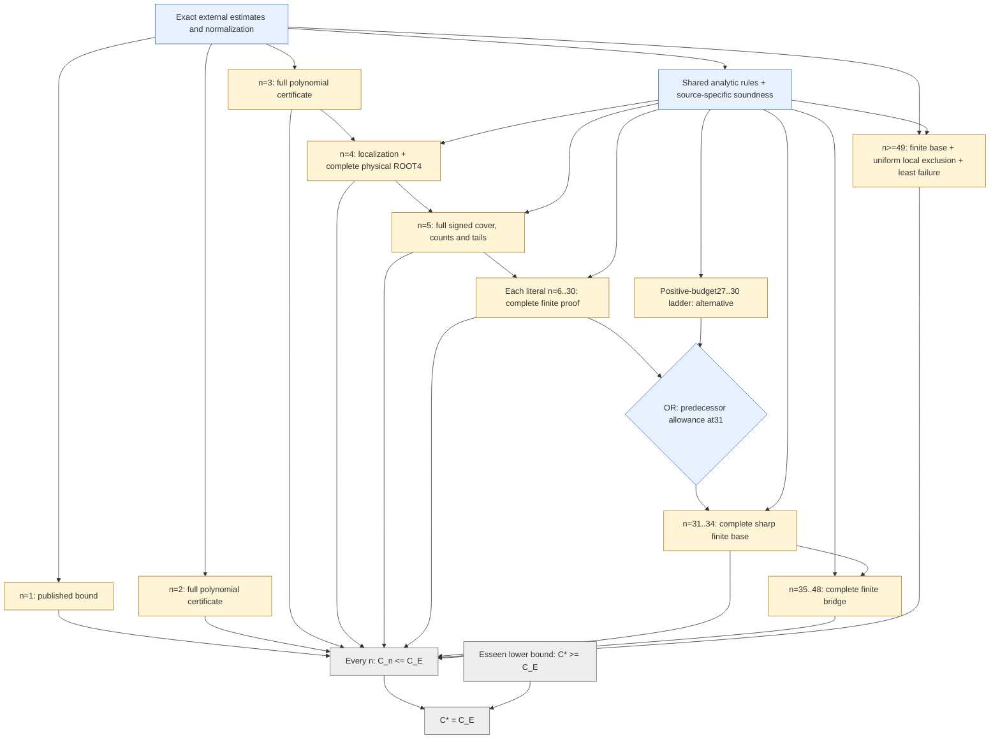
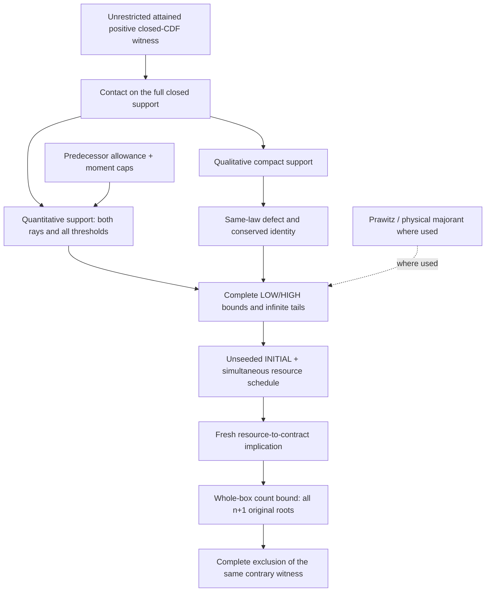

# Logical audit and high-level proof graph

Audit date: 23 October 2026. Source: supplied v4 `berry_esseen_manuscript.tex`,
384,847 bytes, SHA-256
`2b5c9419a5fc2363de21e02e200529b735c52e492f0d398aca6f42650c65eea1`.
The current workspace draft has exactly the same bytes. No numerical notebooks
or mathematical computations were launched for this audit.

## Verdict

The reviewed main implications form a coherent **conditional** architecture.
No structural dependency cycle or confirmed fatal analytic contradiction was
found in the reviewed chain. This is a bounded mathematical audit, not a
verification of every enabled kernel, source-to-lemma correspondence or complete
finite certificate. The unconditional all-index theorem remains open.

The count-score theorem needs an explicit nonnegative own-mass lower bound;
the inspected exact implementation already has that property. The final theorem
should enumerate the finite 31--48 prerequisites. A confinement sign gate is
present in the inspected kernel and all 83 inspected rows satisfy it; it must
stay explicit in the mathematical interface. See [the amendments and
guards](logic_audit_repairs.md).

This does **not** certify "all mathematics finished, only certificate execution
remains". It gives the high-level logical architecture and its remaining
obligations, not a complete graph of every numerical instance and program.

## 1. The upper-bound spine

Arrows denote implications, not completed calculations. Inputs meeting at
the explicit OR node are alternatives; other solid inputs are AND requirements.
Dashed edges apply only where their label requires them. Amber boxes contain finite obligations;
blue denotes an analytic layer; gray conclusions remain unaccepted. Colors are
not PASS statuses. This is the original sufficient 49+ route.

Each certificate box retains all original domains, orientations, boundaries
and analytic/source interfaces. The 31 entry also has an original alternative
positive-budget 27--30 acquisition. Sharp 30 is a stronger predecessor input;
it does not remove separate own-score/support premises. Tail 49 alone does not
cover 31--48. The separate n=3 proof does not consume n=2 merely because its
index is smaller; unrestricted n=3 is a premise of ROOT4.

## 2. Inside an ordinary finite-index arrow

Qualitative compactness comes from contact with positive score **before**
fourth/fifth moments. The conserved identity does not need quantitative
support, Prawitz or a predecessor bound. Quantitative radius acquisition is
separate; there is no required support/Fourier cycle at this level. A complete
direct Fourier or moment exclusion may replace the resource/count branch on
the part it covers. Callbacks consume only facts already acquired for the
same witness; no convergence of infinite resource iteration is presumed.

## 3. Genuine OR alternatives

| Required fact | Alternative sufficient routes | Obligations retained |
|---|---|---|
| Stored n25 allowance q25<=5/16 | Sharp C24<=C_E, giving q25=0; OR acquired auxiliary C24<C_E+1/80 | Actual n25 support, own-score, INITIAL, resources, counts and interfaces. Auxiliary24 does not prove sharp24. |
| Predecessor at31 | Sharp unrestricted30; OR positive-budget27--30 ladder | Literal31 cover and every separate own-score/support premise. |
| Infinite completion | Original finite31--48 plus independent49+; OR sharp through46 plus uniform local exclusion for all n>=47 | Uniformity, zero noise and every finite premise of the chosen route. |

The shorter 47+ composition is proved in [the global/tail
audit](logic_global_tail_audit.md): smoothing bounds `n(C_n-C_E)<.30<.7`
at a least contrary index n>=47; its predecessor allowance is zero and both
deleted predecessors satisfy the required caps. The uniform local theorem
excludes it. This is a new **conditional logical composition**, not completed
arithmetic or permission to edit the current full 14/41 tail replay. Its
minimal executable subset still needs source-specific validation.

## 4. Findings and boundaries

| Item | Result | Consequence |
|---|---|---|
| Attainment at C_n=C_E, atoms, full-support contact | Checked; no blocking gap found | Equality-inclusive first failure has a stated foundation. |
| Original law versus reference law | Checked distinction | Count conditioning and ROOT4 do not reduce arbitrary laws to two/three atoms. |
| Common defect, phase, propagation | Main conditional arguments checked | Every update must preserve one witness and one simultaneous budget. |
| Count identity, vertex bound, zero noise, closed roots | Checked with nonnegative own-mass amendment | All roots and equality faces remain required. |
| n4/n5 reductions | Prior scoped reviews and current composition readback | Complete ROOT4 and the full n5 signed/support/Fourier/count cover remain. |
| Finite induction and tail | No found scalar cycle | No monotonicity of C_n is assumed. Literal-index and uniform premises remain. |
| Selected He--Cheng input | Finite Gaussian statement located and directly checked | No eventual sharpness theorem is imported circularly. |
| Every enabled kernel and proof-to-code link | Independent review incomplete | Cubic/quartic/SOS, tangent/stop-loss/theta/allocation and portfolios require exact rule matching. |
| Implementation coverage and semantic joins | Incomplete | Orientations, seams, endpoints, tails and literal indices need evidence. |
| Numerical certificates | Incomplete, with distinct evidence levels | Checkpoints, historical PASS and conditional completion are not the final theorem. |
| Classical literature | Selected statements have different review levels | Original one-summand and Esseen texts retain their stated readback limitation. |

## 5. Detailed reviews and next priority

- [Foundations, lines159--1650](logic_foundations_audit.md).
- [Fourier/resources/phase/count, lines1650--4815](logic_resource_count_audit.md).
- [Finite-index/global/tail and OR routes](logic_global_tail_audit.md).
- [Finite Gaussian input](logic_gaussian_input_audit.md).
- [Amendments and sign gates](logic_audit_repairs.md).
- Prior [n2/n3](small_indices_analytic_review.md), [n4](analytic_audit.md),
  [n5](n5_analytic_review.md), [Prawitz](prawitz_majorant_review.md) and
  [literature](literature_inputs.md) reviews.

Next: apply explicit amendments in the revised paper and check selected kernel
families and source-bound acquisition/coverage interfaces against this spine.
Preserve existing queued computations. Do not expand the numerical queue to
cover an unresolved logical arrow. No all-index proof node is closed here.
