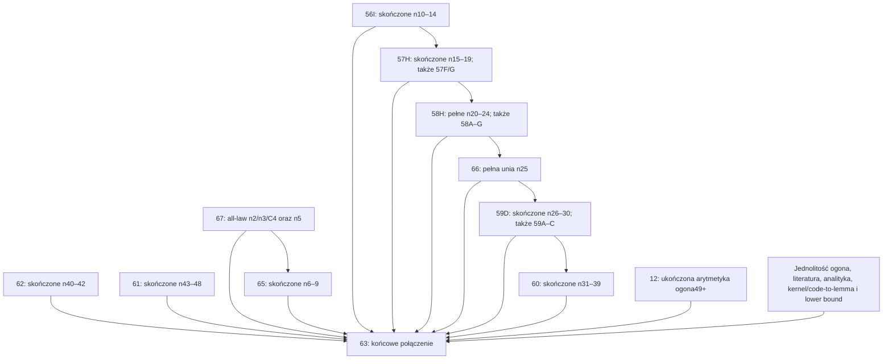

# Potwierdzone obliczenia i dokładna lista pozostałych zadań

Stan: **24 października 2026**, po odczycie rzeczywistych lokalnych ZIP-ów.
To bieżący rejestr postępu; wcześniejsze notatki o kolejce są historyczne.
[Wersja maszynowa](completion_and_remaining_20261024.json) podaje dla każdego eksportu nazwę, rozmiar, SHA256 i zakres weryfikacji.

## Stan istniejących notebooków

- **74** mają zakończony wskazany zakres arytmetyczny.
- **35, 46, 59C** pozostają niekompletne.
- Dla **56H, 57F, 57G, 58G** nie znaleziono lokalnego końcowego ZIP-a. Nie przesądza to o stanie sesji lub wyniku na Dysku.
- **59B** jest wśród 74 zakończeń, ale obecny pełny czytnik odrzuca hash starszego adaptera; zgodność czytnika pozostaje otwarta.
- **56I** jest gotowy w lokalnym przekazaniu kodu, z 29 testami i sprawdzonym bootstrapem. Nie został publicznie dostarczony jako nowy runtime; brak rzeczywistego końcowego wykonania.
- **10 pełnych jednostek** wymaga dokończenia implementacji, testów i późniejszych wykonań: **57H, 58H, 59D, 60, 61, 62, 63, 65, 66, 67**. Istniejące komponenty robocze nie są pełnymi notebookami.

„Zakończenie” dotyczy zakresu konkretnego notebooka. **Pełny dowód pozostaje niezweryfikowany.** Liczba notebooków nie jest procentem matematycznego ukończenia.

## Co sprawdzono w tym odczycie

105 plików to 97 różnych ZIP-ów i osiem identycznych kopii. Wszystkie pliki w 97 archiwach odczytano do końca: zero błędów CRC. Sprawdzono 108 546 wewnętrznych wiązań rozmiar/SHA256, bez niezgodności. Odczytano końcowe SESSION_RESULT, błędy oraz liczniki etapów.

Pełne istniejące czyste czytniki uruchomiono dodatkowo dla 57E, 58D, 58E, 58F, 59A i 59B: pięć PASS oraz jedna odmowa zgodności starego adaptera 59B. Dla pozostałych wyników ten odczyt sprawdza status i integralność wewnętrzną; nie oznacza nowej pełnej rodzinnej ani matematycznej walidacji każdego eksportu. Wcześniejsze dokładniejsze odczyty poszczególnych rodzin zachowują swój opisany zakres.

Nie znaleziono sąsiednich `.zip.sha256` dla tych pobranych eksportów. SHA256 wyliczono lokalnie; wewnętrzna zgodność bajtów nie jest zewnętrznym poświadczeniem prawdziwości matematyki. Nie wykonano ponownie oryginalnych jąder numerycznych. To nie jest obserwacja działających sesji Colaba.

## Aktualne naprawy

| Zadanie | Rzeczywisty stan | Pozostałe działanie |
|---|---|---|
|35|15/326 zaliczonych etapów: support, HIGH, owncaps i wszystkie 12 INITIAL. Pierwsze resources B0 obliczyło 91 paneli, lecz nie przeszło końcowego czytnika. `ValueError: No unbound supervisory import/helper`.|Zdiagnozować różnicę vendor actual/expected. Import portu metadanych przez `exec_module` bez osłony bytecode wskazuje na prawdopodobny dodatkowy `__pycache__`, ale eksport nie dowodzi konkretnej nazwy dodatkowego pliku. Naprawić import/czytnik i test w zwykłym kernelu, odzyskać lub powtórzyć tylko niezaliczony etap B0, wznowić z 15 ukończonych. 311 pozostałych etapów nie jest procentem czasu.|
|46|9 INITIAL zachowanych; owncaps policzone, lecz stary czytnik wymagał liczby 17 zamiast oryginalnej listy 17 kontroli.|Zastosować istniejącą poprawkę i [odzyskanie](finite69_caps_recovery.md); pełnie odczytać owncaps i dokończyć dziewięć resources. Pełne 19 etapów nadal niepotwierdzone.|
|59C|2/16 działań higher; `ValueError: Exact original inline source-hash comparison` przed dalszym pipeline.|Sprawdzić istniejącą poprawkę reprezentacji AST/Python 3.13 i pin poprawionego notebooka; wykonać pełny higher protocol. Nie znaleziono późniejszego sukcesu.|
|59B|Dwa pełne przebiegi po 115 wierszy, 14 działań i 93 kontrole/przebieg; bieżący czytnik odrzuca starszą epokę adaptera.|Zapewnić pełny czytnik dokładnej starej wersji lub jawny sprawdzony most zgodności. Nie edytować starych hashów. Sam błąd zgodności nie uzasadnia powtarzania integracji.|

59B: zgodne są schema, source-plan i mapy oryginalnych źródeł. Różnica adaptera:

```
zapisany: 0a03ca05ae2788118ea7c7c55e16d6b37443a222c0e21b9ee14f30fd267d167a
bieżący: 35213d6c838122bdd3df92b9f89c9097ef4c2d4f2f4eb8ef4211372c0b3f380b
```

## Pełna tabela istniejących zadań

**Z** = zakończona arytmetyka według końcowego ZIP-a, z integralnością wewnętrzną; **V** = dodatkowo pełny czysty czytnik PASS w tym odczycie; **O** = niekompletne; **K** = arytmetyka zakończona, zgodność czytnika otwarta; **?** = brak lokalnego końcowego ZIP-a. Konkretne hashe i finalne stany są w rejestrze JSON.

| Nr | Stan | Zakres i otwarte granice | Wybrany eksport |
|---|---|---|---|
|01|Z|Pełny regionalny COUNT; rodzice i pełna unia n25 pozostają osobne.|`20261023T173523Z-dd027bd6-results.zip`|
|02|Z|Pełny regionalny COUNT; rodzice i pełna unia n25 pozostają osobne.|`20261023T173533Z-3c55a3cd-results.zip`|
|03|Z|Pełny regionalny COUNT; rodzice i pełna unia n25 pozostają osobne.|`20261023T173630Z-c08f3ca5-results.zip`|
|04|Z|Pełny regionalny COUNT; rodzice i pełna unia n25 pozostają osobne.|`20261023T173624Z-bc1358b0-results.zip`|
|05|Z|Pełny regionalny COUNT; rodzice i pełna unia n25 pozostają osobne.|`20261023T173915Z-989ca66d-results.zip`|
|06|Z|Pełny regionalny COUNT; rodzice i pełna unia n25 pozostają osobne.|`20261023T173705Z-95cdbaee-results.zip`|
|07|Z|Pełny regionalny COUNT; rodzice i pełna unia n25 pozostają osobne.|`20261023T173850Z-ca51d9e6-results.zip`|
|08|Z|Obliczenia n2/n3; all-law redukcje i silna teza n3 wymagają osobnego połączenia.|`20261023T102541Z-29f65b56-results.zip`|
|09|Z|B3/B4 INITIAL/resources; warunkowy łańcuch rodziców.|`20261023T111838Z-c4d5fadf-results.zip`|
|10|Z|B3/B4 INITIAL/resources; warunkowy łańcuch rodziców.|`20261023T111953Z-594c65da-results.zip`|
|11|Z|Dwa pełne przebiegi fizycznego ROOT4; all-law C4 pozostaje osobne.|`20261023T112903Z-63d200d0-results.zip`|
|12|Z|14/14 top-level i41/41 retained; BASIC16GiB/18h. Pozostała jednolita implikacja ogona49+ i przesłanki.|`20261023T212745Z-1825b68e-results.zip`|
|13|Z|Cała faza dla wybranego dodatniego closed-CDF gap-free corner; nie całe C5.|`20261023T123333Z-c3b7ecde-results.zip`|
|14|Z|Wybrany pełny auxiliary21; szersze połączenia analityczne osobne.|`20261023T123947Z-243fb15a-results.zip`|
|15|Z|Wybrany pełny auxiliary22; szersze połączenia analityczne osobne.|`20261023T125227Z-08695959-results.zip`|
|16|Z|Wybrany pełny auxiliary23; szersze połączenia analityczne osobne.|`20261023T134824Z-c9a1a91e-results.zip`|
|17|Z|Pełna gałąź stronger24 b0; 12 lasów.|`20261023T145430Z-1fe57fef-results.zip`|
|18|Z|Pełna gałąź stronger24 b1; 9 lasów.|`20261023T151748Z-7393522e-results.zip`|
|19|Z|Pełna gałąź stronger24 b2; 9 lasów.|`20261023T153241Z-da044bd4-results.zip`|
|20|Z|Pełna gałąź stronger24 b3; 8 lasów.|`20261023T155406Z-eeee0789-results.zip`|
|21|Z|Pełna gałąź stronger24 b4; 8 lasów.|`20261023T163842Z-8f5bb9d0-results.zip`|
|22|Z|Pełna gałąź stronger24 b5; 7 lasów.|`20261023T181807Z-d1c20667-results.zip`|
|23|Z|9 eksportów;83 lasy/76088 liści; CONDITIONAL_FRESH_NUMERIC_CHAIN_VERIFIED.|`20261023T201315Z-c98176d8-results.zip`|
|24|Z|7/7 wybranych interfejsów n25; nie pełna unia n25.|`20261023T201326Z-b9ba9687-results.zip`|
|26|Z|17/17 wybranych lasów; zasoby/globalna unia osobne.|`20261023T200813Z-281116a3-results.zip`|
|27|Z|35/35 wybranych lasów; zasoby/globalna unia osobne.|`20261023T201602Z-977d1abb-results.zip`|
|28|Z|23/23 wybranych lasów; zasoby/globalna unia osobne.|`20261023T201950Z-96a65eba-results.zip`|
|29|Z|17/17 wybranych lasów; zasoby/globalna unia osobne.|`20261023T195332Z-fb720309-results.zip`|
|30|Z|30/30 wybranych lasów; zasoby/globalna unia osobne.|`20261023T195800Z-41e40d58-results.zip`|
|31|Z|39/39 wybranych lasów; zasoby/globalna unia osobne.|`20261023T195811Z-b65a398e-results.zip`|
|32|Z|16/16 wybranych lasów; zasoby/globalna unia osobne.|`20261023T200121Z-b9243cbe-results.zip`|
|33|Z|7/7 wybranych lasów; zasoby/globalna unia osobne.|`20261023T200243Z-ea27e752-results.zip`|
|34|Z|6/6 wybranych lasów; zasoby/globalna unia osobne.|`20261023T200609Z-98f2ca63-results.zip`|
|35|O|15/326 zaliczonych: support/HIGH/owncaps i12 INITIAL. Przerwane przy pierwszych resources B0.|`20261024T010521Z-63dedc4c-results.zip`|
|36|Z|Pełne rodzice i odpowiednio17/35/23 bieżące interfejsy B0/B1/B2.|`20261023T191607Z-38dfc33f-results.zip`|
|37|Z|Pełne rodzice i odpowiednio17/35/23 bieżące interfejsy B0/B1/B2.|`20261023T194405Z-8666b9c3-results.zip`|
|38|Z|Pełne rodzice i odpowiednio17/35/23 bieżące interfejsy B0/B1/B2.|`20261023T191804Z-4ec6934d-results.zip`|
|39|Z|Pełne dolne global INITIAL/resources B5; mixed/local/unia osobne.|`20261023T191911Z-1f5e4d3b-results.zip`|
|40|Z|90/90 pełnych lasów COUNT dla n6.|`20261023T202324Z-7d7d0e86-results.zip`|
|41|Z|72/72 pełnych lasów COUNT dla n7.|`20261023T202610Z-a536a0cc-results.zip`|
|42|Z|64/64 pełnych lasów COUNT dla n8.|`20261023T202749Z-aa092c0f-results.zip`|
|43|Z|58/58 pełnych lasów COUNT dla n9.|`20261023T202945Z-e6e9d8aa-results.zip`|
|44|Z|41/41 wybranych działań rodziców n6.|`20261023T213058Z-2949e657-results.zip`|
|45|Z|9/9 pełnych INITIAL dla n7–9.|`20261023T211013Z-8b9c0c02-results.zip`|
|46|O|9 zapisanych INITIAL;19 wymaganych etapów. owncaps readback błąd17 controls; zasoby niedokończone.|`20261023T221209Z-33953096-results.zip`|
|47|Z|Pełne middle n25 B4/B5 acquisition; odpowiednio14/12 działań.|`20261023T195051Z-0afbf933-results.zip`|
|48|Z|Pełne middle n25 B4/B5 acquisition; odpowiednio14/12 działań.|`20261023T213809Z-8d1cde13-results.zip`|
|49|Z|14/14 high-beta3 acquisition; połączenia regionalne i globalne osobne.|`20261023T204257Z-5cbd2c15-results.zip`|
|50|Z|217/217 pełnych wybranych COUNT; finalizacja po naprawie ukończona.|`20261023T224423Z-a49c40aa-results.zip`|
|51|Z|147/147 pełnych wybranych COUNT; finalizacja po naprawie ukończona.|`20261023T222904Z-896527af-results.zip`|
|52|Z|163/163 pełnych wybranych COUNT; finalizacja po naprawie ukończona.|`20261023T224907Z-689e1d92-results.zip`|
|53|Z|80/80 pełnych COUNT;76306 liści; uwzględniony naprawiony64 identity edge.|`20261023T224032Z-c2e02cfb-results.zip`|
|54|Z|282/282 pełnych wybranych COUNT; finalizacja po naprawie ukończona.|`20261023T232703Z-8efe9415-results.zip`|
|55|Z|120/120 pełnych wybranych COUNT; finalizacja po naprawie ukończona.|`20261024T014047Z-516cc64f-results.zip`|
|56A|Z|Auxiliary Fourier, literal n9–14.|`20261023T231655Z-bf156069-results.zip`|
|56B|Z|Supported Fourier, literal n9–14; support and whole-range joins remain separate.|`20261023T232402Z-d516197a-results.zip`|
|56C|Z|High-rho Fourier n10–14: 80 strips / 400 exact rows.|`20261023T232747Z-2444d528-results.zip`|
|56D|Z|Corner Fourier n10–14.|`20261023T234556Z-6920e6b6-results.zip`|
|56E|Z|Supported HIGH n10–14.|`20261024T002515Z-6469403c-results.zip`|
|56F|Z|Coarse support Fourier n10–14.|`20261024T002644Z-760fc753-results.zip`|
|56G|Z|5/5 przypadków n10–14 B0;20/20 wywołań;500 paneli resources.|`20261024T010956Z-9539c53a-results.zip`|
|56H|?|Niepotwierdzone lokalnym eksportem|—|
|56K|Z|Scalar kappa 62/625 certificate; 324 identities / 21 controls.|`20261024T000318Z-44ff164d-results.zip`|
|57A|Z|Auxiliary Fourier n14–19.|`20261024T001640Z-ccad23fa-results.zip`|
|57B|Z|Supported Fourier n14–19.|`20261024T002020Z-51367635-results.zip`|
|57C|Z|High-rho Fourier n14–19.|`20261024T002009Z-456583eb-results.zip`|
|57D|Z|Support n15–19.|`20261024T002654Z-bded53b2-results.zip`|
|57E|V|Compensated HIGH n15–19.|`20261024T003827Z-7b64d6a9-results.zip`|
|57F|?|Niepotwierdzone lokalnym eksportem|—|
|57G|?|Niepotwierdzone lokalnym eksportem|—|
|58A|Z|Actual n21–24 high-rho support.|`20261024T001924Z-8164bb3e-results.zip`|
|58B|Z|4/4 przypadki n21–24 B0; pełne INITIAL/resources.|`20261024T010828Z-ba372f5d-results.zip`|
|58C|Z|4/4 przypadki n21–24 BN; pełne INITIAL/resources.|`20261024T010927Z-de4fe729-results.zip`|
|58D|V|Auxiliary n20–24 Fourier transaction.|`20261024T012443Z-004a4d9c-results.zip`|
|58E|V|Universal n20–24 Fourier transaction.|`20261024T012644Z-505d232a-results.zip`|
|58F|V|Supported n20–24 Fourier transaction.|`20261024T012707Z-b4208f3a-results.zip`|
|58G|?|Niepotwierdzone lokalnym eksportem|—|
|59A|V|2 pełne przebiegi;23 stripy,115 wierszy/przebieg,18 native controls.|`20261024T012758Z-91e52e1f-results.zip`|
|59B|K|2 pełne przebiegi;115 wierszy/przebieg,14 działań. Bieżący czytnik wymaga zgodności ze starszym adapterem.|`20261024T023936Z-e903a551-results.zip`|
|59C|O|Przerwane po2/16 działaniach; błąd formatu AST/source-hash przed dalszym liczeniem.|`20261024T013614Z-7fc5851f-results.zip`|
|64|Z|Pełne odzyskanie n27/p41:28 korzeni,6310 węzłów,3169 liści; to składnik53.|`20261023T220120Z-244a55cc-results.zip`|

## Dokładnie jakie pełne jednostki pozostały

Oryginalny przydział obejmuje 13 nowych plików: 57F/G są już publicznie dostarczone, 56I dostarczono lokalnie, dziesięć pełnych jednostek wymaga dokończenia implementacji. Te cztery różne stany — implementacja, publiczne dostarczenie, wykonanie i matematyczna akceptacja — nie są zamienne.

| Jednostka | Stan implementacji/dostarczenia | Co ma zamknąć | Dokładny inwentarz |
|---|---|---|---|
|56I|Gotowa lokalna implementacja, notebook i testy; brak publicznego dostarczenia tej implementacji oraz końcowego wykonania.|Wykonać pełny n10–14 join: 1000 dyspozycji, 202 interfejsy, 20 ograniczeń podpaneli, 217 lasów i skończona indukcja.|`finite1014_join_source_plan.json` (lokalny pakiet źródeł)|
|57H|Dokończyć implementację; istnieją przygotowane komponenty i źródła.|Sześć oryginalnych kontroli, import 56I/57A–G/56K oraz 147 COUNT; wszystkie 1000 dyspozycji i 147 interfejsów, indukcja 14→19.|[`finite1519_join_control_source_plan.json`](finite1519_join_control_source_plan.json)|
|58H|Dokończyć implementację; prymitywy przygotowane lokalnie.|25 oryginalnych wywołań, pełne n20, 300 wierszy zasobów, osiem połączeń pasm n21–24 i indukcja 20→24.|[`remaining_58_69_execution_partition.json`](remaining_58_69_execution_partition.json)|
|59D|Zaimplementować pełne wykonanie i połączenie.|Obie rodziny support n26–30, floor25 INITIAL/resources, transfery; ponownie użyć 80 COUNT 53/64 i 445 wierszy Fourier 59A–C.|[`remaining57_59_delivery_partition.json`](remaining57_59_delivery_partition.json)|
|60|Zaimplementować pełne wykonanie i połączenie.|Osiem floor31 families, 1713 ewaluacji support n32–34 i pozostali rodzice/interfejsy n35–39; zachować COUNT 54/55.|[`remaining31_39_delivery_partition.json`](remaining31_39_delivery_partition.json)|
|61|Zaimplementować pełne wykonanie i połączenie.|Skończone n43–48: 33 top-level scopes; pełne signed LOW 78 i 74 wiersze, właściwe retained inputs z 12.|[`finite_remaining_batch_plan.json`](finite_remaining_batch_plan.json)|
|62|Zaimplementować pełne wykonanie i połączenie.|Skończone n40–42: sześć sekcji, 48 top-level / 59 fizycznych wywołań; capture potomków; późniejsze bindery odłożyć do 63.|[`finite_remaining_batch_plan.json`](finite_remaining_batch_plan.json)|
|65|Zaimplementować pełne wykonanie i połączenie.|Bridge/radius Fourier, 12 HIGH, 36 celów support / 72 signed rays, 284 interfejsy COUNT i indukcja n6–9; wymaga pełnego 46.|[`remaining_58_69_execution_partition.json`](remaining_58_69_execution_partition.json)|
|66|Dokończyć implementację dziewięciu sekcji; samo odtworzenie źródeł nie jest wykonaniem.|11 ordinary B5, dwie mixed p24/p25, dziesięć supplied ordinary, supplements i regionalne INITIAL/resources/local loops; pełna unia 20 obszarów n25.|[`remaining_n25_execution_partition.json`](remaining_n25_execution_partition.json)|
|67|Zaimplementować pełne wykonanie i połączenie.|All-law n2/n3/C4 oraz pełny n5: 22 oryginalne wywołania, support/complement i semantyczne resource/count joins; wykorzystać 08/11/13/35.|[`remaining_n5_delivery_partition.json`](remaining_n5_delivery_partition.json)|
|63|Zaimplementować końcowy collector po uzyskaniu wszystkich wymaganych przesłanek.|Każde n1–48, jednolity ogon n≥49, analityka/literatura/kernel/code-to-lemma, pełne domeny i Esseen lower bound.|[`remaining_notebooks_closed_plan.json`](remaining_notebooks_closed_plan.json)|

Nie dodawać nowych numerów dla pojedynczych podetapów powyższych jednostek. Zachować pełne źródłowe inwentarze; fixed grouping nie gwarantuje wykonania każdego notebooka w jednej sesji.

## Kolejność i matematyczne granice



To graf przydziału i kolejności pracy z istniejącego planu; pomija szczegółowe upstreamy z tabel źródłowych. Nie jest dowodem poprawności strzałek. n10 ma własną wybraną trasę bazową; nie dopisywać zależności od sharp n9. Dla 61/62 skończone tezy trzeba oddzielić od odłożonych binderów, aby uniknąć cyklu.

- 67 musi pozyskać all-law C4 **przed** n5. ROOT4 potrzebuje `C3 ≤ 59·sqrt(3)/250`; samo `C3 ≤ CE` jest za słabe.
- 66 wymaga całej unii: sześć lower-rho + siedem middle signed-beta + sześć high signed-beta + jeden uniwersalny rho tail. Beta oznacza `E[X|X|]`. Źródła 11 ordinary i dwóch mixed parent capsules odtworzono; to nie są świeżo zaakceptowane lasy.
- 12 dostarcza pełną wybraną arytmetykę, ale jednolita implikacja dla wszystkich całkowitych n≥49, finite-base i least-failure wymagają poprawnego połączenia. Nie zakładać monotoniczności `C_n`.
- W finale pozostają jawne analityczne/literaturowe przesłanki, poprawność aktywnych jąder, pełne domeny i oba znaki, same-law/current-parent interfejsy oraz lower bound. Ukończenie obliczeń nie zamienia ich automatycznie w dowód ogólny.

## Co zachować bez ponownego liczenia

01–07 i 12 mają późniejsze sukcesy po wcześniejszych przerwaniach. 50/51/52/54/55 mają późniejsze kompletne finalizacje po dawnym `KeyError: remaining_obligations`; ich COUNT nie jest ponownie w kolejce. 53 uwzględnia 64. Zachować również wszystkie ukończone zakresy tabeli, 15 etapów 35 i dziewięć INITIAL 46.

W razie zmiany rodzica lub adaptera zachować stare receipt/capture bajt w bajt. Wystawić osobny sprawdzony most zgodności; nie podmieniać starego hasha i nie ufać samemu statusowi COMPLETE.

Większe nowe działania mają limit CPU i wall 82 800 s (23 h) na działanie, pełny capture i cache wyłącznie ukończonych zweryfikowanych etapów. Jest to budżet działania, nie gwarancja czasu całej partii. Weryfikacja i wykonanie muszą rozróżniać gotowy kod, ukończoną arytmetykę, pozyskanych rodziców, skończoną implikację i pełny globalny dowód.

Nie publikowano tu lokalnych ZIP-ów wynikowych, prywatnych odnośników, lokalnych ścieżek ani roboczego kodu i notebooków z przekazania. To aktualizacja dokumentacji postępu i obowiązków.
