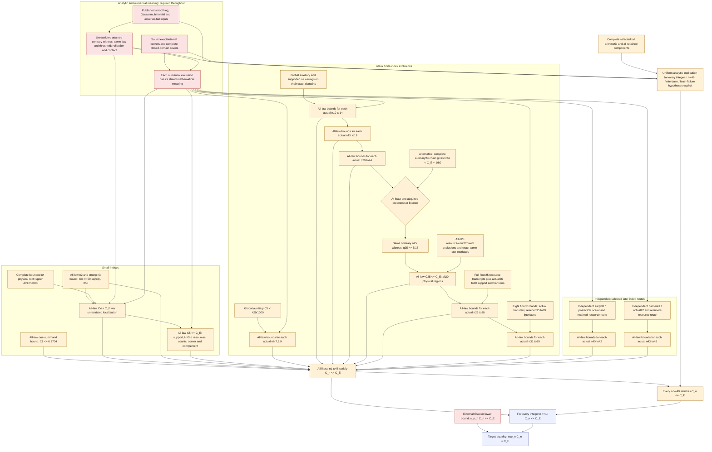
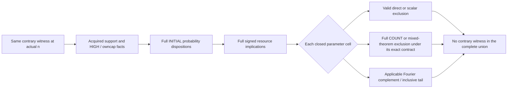

# Proof graph: statements and dependencies

**This is the intended proof structure, with open premises visible. It is not
a declaration that the proof is complete.** An arrow means that the earlier
statement or same-law implication is needed for the next statement. A successful
computation establishes only its declared conditional numerical scope.

For standardized iid real laws with finite third absolute moment, write
`C_n = sup_P sqrt(n)/E|X|^3 * sup_H |P(S_n <= H)-Phi(H/sqrt(n))|` and
`C_E=(3+sqrt(10))/(6*sqrt(2*pi))`. The target is `sup_n C_n=C_E`.

Orange nodes are proof steps whose complete acquisition is still to be checked.
Red nodes are substantive analytic, literature or kernel/interface premises;
their placement is not a claim that they are false. Blue nodes are the target
conclusions. The diagram deliberately does not colour an all-law theorem as
proved merely because its numerical component has completed.

## How one finite-index exclusion works

For a fixed literal n, assume a contrary standardized law and threshold with
normalized discrepancy at least the target. Use the **unrestricted**
attainment/localization/contact reduction before subdividing its parameters.
Acquire support before invoking any support-dependent higher-moment or Fourier
bound. The same marginal and threshold must satisfy all facts passed onward.

Every possibility has to be covered, including shared endpoints, both discrepancy
orientations, zero-noise/equality cases and the unbounded tails. A criterion that
fails to exclude a cell does not close that cell. A bound from another marginal,
an unsigned replacement of a signed moment, or a scalar maximum does not provide
the simultaneous resource-to-contract implication. These are the reasons the
interfaces are explicit proof steps.

## Open edges that the diagram does not hide

- The n25 union needs fresh accepted replacements for eleven ordinary cases
  and current parent epochs for two mixed routes. The reconstruction basis is
  now concrete: all eight V12 bases and combined-V14 ingredients are supplied;
  four p33 contracts/checkers match their historical hashes; all93 mixed-parent
  native files and both checkers are recoverable. Current source/registry
  adapters, fresh complete searches/replays and same-law acquisition remain
  necessary. Naming the complete20-piece cover does not close its pieces.
  The [source reconstruction is now implemented](n25_b5_reconstruction_execution.md)
  and its thirteen source capsules were actually assembled and revalidated;
  they remain inputs of the single66 delivery unit.
- Current source/capture epochs and several finite-only semantic joins remain
  to be implemented. Historical global composers sometimes import later tails;
  those full joins belong after their finite components, not as assumptions
  of the earlier components. The graph therefore has no final-theorem arrow
  back into an earlier proof.
- Analytic/literature and code-to-lemma obligations remain real work. Scoped
  successful arithmetic alone does not discharge them. In particular, n4
  consumes the **strong quantitative n3 bound**, not merely C3<=C_E.
- The predecessor input for n25 is an OR: acquired sharp24 or the complete
  weaker auxiliary24 chain. Neither choice removes attainment/contact,
  support/owncap or current resource/count obligations.
- The49+ statement must be uniform in the integer n under its precise
  hypotheses. Checking finitely many n or assuming monotonicity of C_n would
  not suffice.

The mathematical [conditional sufficiency argument](remaining_notebooks_sufficiency.md)
states the hypotheses of this graph. Notebook-to-statement assignments and exact
source inventories are maintained separately in the
[delivery specification](remaining_notebooks_closed_plan.md) and its
[machine-readable companion](remaining_notebooks_closed_plan.json).
The specification checker verifies accounting, exact endpoints and graph
consistency; it does not evaluate the original mathematics or certify this proof.
