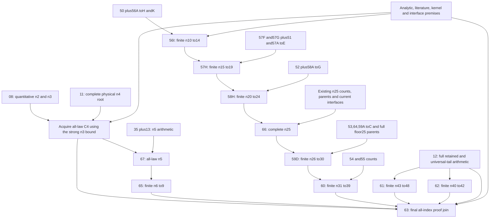

# Remaining selected notebook delivery plan

Planning snapshot: 24 October 2026. This replaces an open-ended succession of
new notebook suggestions with a fixed delivery partition. It is a specification,
not fresh arithmetic acceptance or a proof that currently missing source inputs
can be recovered. Runnable notebooks are delivered only after their entire
assigned scope is implemented and checked.

**13 new files are assigned: 12 containing numerical work or bounded original
mathematical controls, and 1 final evidence/proof collector.** The grouping is an
engineering choice, not a theorem about the minimum possible number of files.
Two numerical wrappers (57F/G) are implemented but unpublished; the other eleven
delivery units still need implementation. Existing repairs are separate from
this new-file count. An individual notebook may contain many complete cached
stages and require several sessions.

| New file | Exact assigned scope | Existing work to preserve |
|---|---|---|
| **56I** | n10--14 finite join; seven retained review/control scopes, including bounded numerical controls; 1,000 probability dispositions, 202 acquired panel interfaces, 20 subpanel restrictions, 217 forests | 50, 56A--H/K |
| **57F** | n15--19 B0: five full INITIAL/resource cases, 20 original calls | 57E HIGH |
| **57G** | n15--19 BN: five full INITIAL/resource cases, 20 original calls | 57E HIGH |
| **57H** | n15--19 retained bounded HIGH/range/mutation controls plus evidence/proof join: 1,000 dispositions, 147 exact resource/count interfaces and ordered finite induction | 51, 57A--G, 56I |
| **58H** | Six complete stages: actual20 coarse/narrow/feedback INITIAL, complete resources, scalar/current contract joins, actual20 union, eight21--24 band joins | 52, 58A--G |
| **59D** | Both actual26--30 support families, floor25 transfers, thirteen fixed scalar/control/adapter calls, full80-count/445-Fourier finite join | 53/64, 59A--C, whole floor25 parents |
| **60** | Eight floor31 families; actual32--34 support/transfers; full finite35--39 nonCOUNT parents and interfaces | 54/55; no repeat of their completed counts |
| **61** | Complete cutoff44/cutoff43 acquisition and finite43--48 evidence: 33 selected top-level scopes/calls | Exact completed12 retained inputs |
| **62** | Complete actual40--42 acquisition: six sections, 48 top-level/59 physical calls including nested children; finite-only export | Exact completed12 retained inputs |
| **63** | Final evidence/proof collector: literal1--48, universal49+ implication, all analytic/literature/kernel obligations and lower bound | Every valid earlier export |
| **65** | Remaining6--9 bridge/radius Fourier, HIGH, full signed-ray support, resource/count joins and induction; explicit auxiliary5 alternative if necessary | 40--46, exact35 coarse fact |
| **66** | All remaining n25 sources/calculations and full20-piece physical union; detailed nine-stage inventory below | 01--07, 09/10, 14--24, 26--34, 36--39, 47--49 |
| **67** | Early all-law n2/n3/C4 acquisition; full C5 acquisition with 14 original bounded-control programs, four support calls, two full current-context complement integrations/accept/full readback, 25 regional/final semantic reference calls | 08/11/13/35; preserve every compatible completed stage |

All larger new numerical batches have a **82,800-second (23-hour) session wall
ceiling** and complete-stage caches. This is a stopping budget, not a runtime
estimate. Partly completed numerical stages are not silently accepted. Valid
completed stages are revalidated and reused. Existing running notebooks keep
their original source/budget identities unless a specific repair is necessary.

## n25 is an explicit blocked work package, not a blank collector

The companion [n25 machine specification](remaining_n25_execution_partition.json)
assigns every one of the 53 previously enumerated nonCOUNT source entries to a
new stage or a named reuse. These 53 entries include alternative/source wrappers;
they are not 53 independent mathematical calculations. Its nine stages are:

1. Lower B3/B4 supplements: p30 S1, current p31/p32 V14 contact and outward
   rounding, p34 selection and complete regional/current count interfaces.
2. **Eleven missing ordinary lower-B5 capsules:** V14 p26--32 and four V12
   p33 quarters. Recover exact inputs or build and fully justify a matching
   replacement route. No successful replacement is asserted.
3. **Both mixed p24/p25 routes:** supplied mixed forests/acceptors, missing
   original parent capsules, all scalar/theorem/derived-leaf acquisitions.
   An ordinary COUNT acceptor cannot replace either mixed protocol.
4. **Ten supplied additional ordinary forests:** seven high-beta2 p17--23 and
   three middle-positive-B3 p21--23, with full original acceptance/controls.
5. Complete high-beta2 INITIAL/global resources and seven selected local
   acquisitions, preserving each exact/cached source epoch and the 16-cycle p23.
6. Complete middle-positive-B3 parents and all eight local panels20--27.
7. All middle-positive B0/B1/B2 INITIAL/resource/local families.
8. Five inherited upper families: high-negative, middle-negative, quarter2,
   high-beta0 and high-beta1 mixed, including complete resource/local loops.
9. Every current same-law resource/count/mixed interface, auxiliary24/contact
   license and complete closed physical union, including the universal rho tail.

The physical cover is **6 lower-rho pieces + 7 middle signed-beta pieces +
6 high signed-beta pieces + 1 universal rho tail = 20 pieces**. Thirteen old
selected records are not thirteen disjoint regions. Source recoverability and
complete runtime closures remain open. Merely choosing one file66 does not
solve these problems or bound the runtime of replacement searches.

## Acquisition graph

Arrows below mean mathematical acquisition/current-evidence dependencies.
Conditional numerical stages can run earlier in parallel; this does not acquire
their premises. Literatures and common analytic/kernel requirements feed every
applicable proof node, even where omitted from this compact diagram.

The missing65→56I arrow is intentional: the actual selected n10 route uses
fresh auxiliary/supported n9 ceilings in56A/B rather than sharpglobal C9.
The n6--9 theorem is still separately mandatory for the all-index conjunction.
Likewise61/62 have their own literal scalar/retained routes; neither may silently
be credited with the other package's conclusion. Their full all-tail binders
are deferred to63, after both finite exports exist.

The n3 input to C4 is the stronger quantitative bound
`C3 <= 59*sqrt(3)/250`, not just `C3 <= C_E`. The acquisition of C4 occurs
before the n5 step inside67; assignment of its final evidence to63 must not make the entire
all-index theorem a prerequisite of67.

## Why old global composers cannot simply be launched unchanged

The selected old56 composer imports an eventual15 result;57 imports eventual20;
59 imports tail31;60's historical all-tail binder imports40;62's global40
binder imports tail43. Those are outgoing final-composition dependencies.
Making them incoming prerequisites of the corresponding earlier finite proof
would create a circle. The planned current collectors must preserve all actual
numerical and scalar checks while exporting their **finite conditional**
conclusions;63 discharges the complete conjunction and deferred tail binders.
This is an explicit implementation requirement, not an already implemented fix.

Existing COUNT wrappers sometimes fully accept a supplied forest without a
fresh constructor capture. A current semantic join must validate that full
candidate/source/contract/acceptance evidence; it must not fabricate an old
constructor capture demanded by an unchanged historical ledger.

## What has actually been checked at this planning stage

The machine specification assigns every node of the original obligations
manifest, each literal index1--48 and the universal49+ obligation. The standard
library checker rejects missing indices, omitted mixed routes/source families,
shifted exact n25 seams, stale source anchors, false acceptance flags and global
dependency cycles. Its rational scalar checks establish the stated n25 endpoint
guards **conditional on the relevant moment/tail lemmas**. Negative fixtures
exercise these failures. No original mathematical program is run by this check.

This is an accounting/conditional-reduction check. It does not establish all
numeric inequalities, code-to-lemma soundness, analytic premises or successful
recovery of missing n25 sources. The companion
[sufficiency argument](remaining_notebooks_sufficiency.md) states precisely
what would imply the theorem and which premises remain open. Therefore the
present plan does **not** claim that only computation and paper writing remain.
